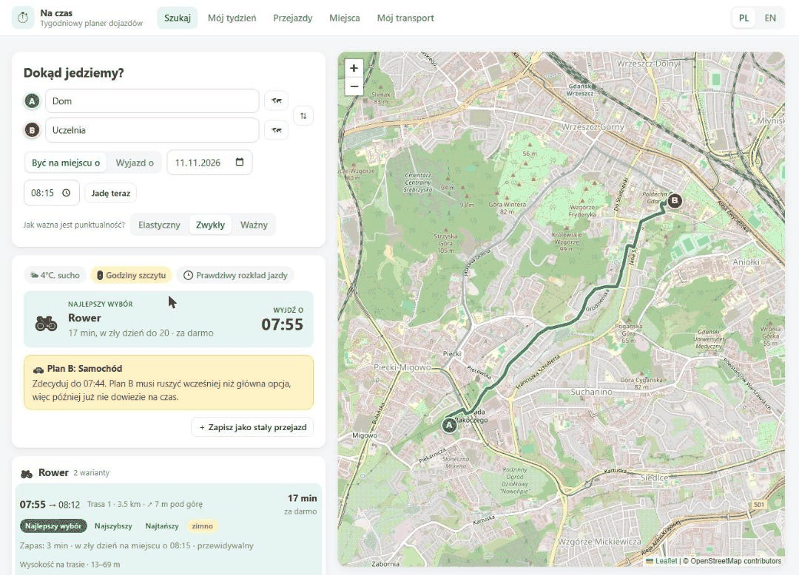

# Na czas · planer dojazdów

Aplikacja odpowiada na pytanie, które zadaję sobie co rano: **czym dziś jechać i o której
najpóźniej muszę o tym zdecydować?**

Wybierasz skąd i dokąd (zapisane miejsce, adres albo kliknięcie na mapie) i od razu widzisz
porównanie: samochód, taxi, komunikacja miejska z prawdziwego rozkładu, rower, hulajnoga
i spacer. Każdą opcję można zobaczyć na mapie. Trasy, którymi jeździsz regularnie, zapisujesz
jednym kliknięciem i dostajesz plan na cały tydzień.

**Wersja online: https://na-czas.onrender.com** (darmowy hosting: po dłuższej przerwie
pierwsze otwarcie trwa około minuty, a dane wracają do przykładowych po restarcie)



## Creative twist: plan B i „punkt bez powrotu”

Zwykły planer mówi „jedź samochodem, 25 minut”. Problem pojawia się pięć minut przed wyjściem,
gdy okazuje się, że jest korek, a autobus, który by mnie uratował, odjechał kwadrans temu.

Dlatego przy każdym przejeździe aplikacja pokazuje:

- **O której wyjść.** Czas nie jest liczony ze średniej, tylko z zapasem zależnym od tego, jak
  nieprzewidywalny jest dany środek transportu i jak ważny jest przejazd (na egzamin zapas
  jest większy niż na siłownię).
- **Plan B** z innej „rodziny” transportu. Jeśli główną opcją jest samochód, planem B nie
  będzie taxi, bo stanie w tym samym korku.
- **„Zdecyduj do”.** Jeśli plan B musi ruszyć wcześniej niż główna opcja, aplikacja mówi
  wprost, do której godziny można jeszcze zmienić zdanie, na przykład: „Plan B: autobus 168
  z przystanku Park Naukowo-Technologiczny, zdecyduj do 07:40”.
- **Ryzykowne połączenia.** Kurs, który według rozkładu dojeżdża „na styk”, jest oznaczony
  jako „za mały zapas” i nie zostanie polecony na ważny przejazd.

Jeśli mimo wszystko jest już za późno, aplikacja pokazuje najszybszą opcję i szacowane
spóźnienie.

## Funkcje

- **Szybkie wyszukiwanie** (ekran główny): skąd, dokąd, „być na miejscu o” albo „wyjazd o”,
  przycisk „Jadę teraz”. Wyniki pojawiają się od razu po wybraniu obu punktów.
- **Komunikacja miejska z prawdziwego rozkładu**: do pięciu różnych połączeń (także
  z przesiadką i z bliższego przystanku), numery linii, gdzie
  wsiąść, gdzie się przesiąść, gdzie wysiąść, ile przystanków i ile dojścia pieszo.
- **Mapa**: trasa wybranej opcji, przystanki wsiadania, przesiadki i wysiadania, a dla roweru
  także alternatywne trasy.
- **Rower z uwzględnieniem wysokości**: do trzech tras, suma podjazdów i profil wysokości.
  Zwykły rower zwalnia pod górę znacznie bardziej niż elektryczny (przełącznik w profilu).
- **Korki zależne od godziny** oraz **prawdziwa pogoda** na godzinę przejazdu. Deszcz i zimno
  obniżają ocenę roweru i spaceru, a deszcz dodatkowo wydłuża jazdę samochodem.
- **Koszty**: paliwo (spalanie × cena × dystans) i parking, bilet jednorazowy albo droższy
  przy przesiadce, 0 zł z biletem miesięcznym, taryfa taxi.
- **Mój tydzień**: plan na 7 dni dla zapisanych przejazdów, z rekomendacją i planem B.
- **Podsumowanie tygodnia**: krótki tekst o tym, na co uważać. Z kluczem API pisze je AI,
  bez klucza działa wersja regułowa.
- **CRUD** przejazdów i miejsc oraz edycja profilu transportowego.
- **Dwa języki**: polski i angielski.

Dane demonstracyjne dotyczą Gdańska (dom na Morenie, Politechnika Gdańska, Oliwa), ale
aplikacja działa wszędzie tam, gdzie dostępne są otwarte rozkłady jazdy.

## Technologie

| Warstwa | Wybór |
|---|---|
| Back-end | Python 3.11+, FastAPI, SQLAlchemy 2, Pydantic 2, SQLite |
| Front-end | React 19, TypeScript, Vite, TanStack Query, React Router, Leaflet |
| AI (opcjonalnie) | Claude przez oficjalne SDK `anthropic` |
| Testy | pytest (37 testów: logika planowania, wybór połączeń i API) |

Wszystkie dane zewnętrzne pochodzą z darmowych usług, które **nie wymagają klucza**:

| Dane | Usługa |
|---|---|
| Rozkłady i połączenia komunikacji | [Transitous](https://transitous.org) (otwarte dane GTFS) |
| Trasy rowerowe z wysokością | [BRouter](https://brouter.de) |
| Trasy samochodowe i piesze | OSRM |
| Pogoda | Open-Meteo |
| Wyszukiwanie adresów, podkład mapy | Nominatim, OpenStreetMap |

### Struktura projektu

```
backend/
  app/
    main.py            start aplikacji, CORS, rejestracja routerów
    config.py          ustawienia z .env
    models.py          tabele: Profile, Place, Trip
    schemas.py         modele żądań i odpowiedzi API
    routers/           warstwa HTTP: places, trips, profile, plan
    services/
      planner.py       rdzeń: porównanie opcji, wybór i plan B (czyste funkcje)
      traffic.py       model korków zależny od dnia i godziny
      routing.py       trasy: samochód, pieszo, rower (z zapasowym szacowaniem)
      transit.py       połączenia komunikacji z rozkładu
      weather.py       prognoza pogody z pamięcią podręczną
      journey.py       jeden przejazd: zbiera dane równolegle i uruchamia planner
      week.py          plan tygodnia z zapisanych przejazdów
      advisor.py       podsumowanie: AI albo reguły
  tests/
frontend/
  src/
    api/               klient HTTP, typy, hooki React Query
    components/        mapa trasy, lista opcji, pole wyboru miejsca, formularze, wykresy
    pages/             Szukaj, Mój tydzień, Przejazdy, Miejsca, Mój transport
    i18n/              tłumaczenia PL / EN
    lib/               formatowanie, kolory i ikony środków transportu
```

### API

| Metoda | Ścieżka | Opis |
|---|---|---|
| GET, POST | `/api/places` | lista i dodawanie miejsc |
| GET, PUT, DELETE | `/api/places/{id}` | jedno miejsce (409, gdy używa go przejazd) |
| GET | `/api/places/search?q=` | wyszukiwanie adresu |
| GET, POST | `/api/trips` | lista i dodawanie przejazdów |
| GET, PUT, DELETE | `/api/trips/{id}` | jeden przejazd |
| GET, PUT | `/api/profile` | profil transportowy |
| POST | `/api/plan/journey` | porównanie opcji dla jednego przejazdu, z geometrią tras |
| GET | `/api/plan/week?start=&now=` | plan na 7 dni (bez geometrii) |
| GET | `/api/plan/traffic?day=` | krzywa ruchu dla danego dnia |
| POST | `/api/plan/advice` | podsumowanie tygodnia |

Interaktywna dokumentacja (Swagger) jest dostępna pod `http://localhost:8000/docs`.

### Ciekawsze rozwiązania

- **Jak liczony jest czas wyjścia.** Każda opcja ma czas typowy i czas „w zły dzień” (około
  95. percentyla). Z tej pary wyznaczam odchylenie i dobieram zapas tak, aby zdążyć
  z prawdopodobieństwem 75%, 90% lub 97%, zależnie od ważności przejazdu. Dzięki temu
  nieprzewidywalny środek sam „płaci” za swoją nieprzewidywalność.
- **Rozkład jazdy ma sztywne godziny.** Kursu nie da się przesunąć o trzy minuty, więc dla
  połączeń z rozkładu sprawdzam, czy zapas przed terminem wystarcza. Ryzyko liczę
  z opóźnień autobusów w korku i z krótkich przesiadek (mniej niż 3 minuty na zmianę).
- **Jedna ocena zamiast wielu reguł.** Opcje porównuję uogólnionym kosztem w złotych:
  pieniądze + czas przeliczony na pieniądze + niewygoda (wysiłek, podjazdy, deszcz, zimno).
  Priorytet użytkownika zmienia tylko wartość minuty.
- **Korki a godzina wyjazdu.** Czas jazdy zależy od korków, a korki od tego, kiedy jadę,
  więc szacunek jest uściślany w kilku iteracjach.
- **Model korków jest wymienny.** Nie istnieje darmowe API z prognozą korków bez klucza,
  więc czas bez korków pochodzi z OSRM, a korki z własnej krzywej w `traffic.py`. Podmiana
  na TomTom lub Google Routes wymaga zmiany jednej funkcji.
- **Aplikacja działa także bez usług zewnętrznych.** Każde źródło ma zapasowy wariant: brak
  rozkładu oznacza szacunek komunikacji, brak tras oznacza dystans z linii prostej, brak
  prognozy oznacza pominięcie pogody, a brak klucza AI oznacza podsumowanie regułowe.
- **Źródła odpytywane są równolegle**, więc jedno wyszukiwanie trwa około 2 sekund, a wyniki
  są trzymane w pamięci podręcznej.
- **AI nie liczy, tylko opisuje.** Model dostaje gotowy, wyliczony plan w JSON i zamienia
  go na kilka zdań. Liczby zawsze pochodzą z deterministycznego kodu.
- **Logika planowania to czyste funkcje** bez dostępu do sieci i bazy, dlatego testy
  jednostkowe są proste i szybkie.

## Uruchomienie lokalne

Wymagania: **Python 3.11+** i **Node.js 20+**. Potrzebne są dwa terminale.

### 1. API (terminal 1)

```bash
cd backend
python -m venv .venv

# Windows (PowerShell)
.venv\Scripts\Activate.ps1
# macOS / Linux
source .venv/bin/activate

pip install -r requirements.txt
uvicorn app.main:app --reload
```

API działa pod `http://localhost:8000`. Przy pierwszym starcie tworzy plik `commute.db`
i wypełnia go przykładowym tygodniem w Gdańsku.

### 2. Front-end (terminal 2)

```bash
cd frontend
npm install
npm run dev
```

Aplikacja działa pod `http://localhost:5173`.

### 3. Opcjonalnie: podsumowanie pisane przez AI

```bash
cd backend
cp .env.example .env      # Windows: copy .env.example .env
```

W pliku `.env` wpisz `ANTHROPIC_API_KEY=...` i uruchom API ponownie. Bez klucza wszystko
działa tak samo, a podsumowanie tworzą reguły.

### Jeden kontener (wdrożenie)

Do wdrożenia służy `Dockerfile`: buduje front-end, a API serwuje go razem z `/api`
(`SERVE_FRONTEND=true`). Plik `render.yaml` pozwala uruchomić całość na Render jednym
kliknięciem.

```bash
docker build -t na-czas .
docker run -p 8000:8000 na-czas      # http://localhost:8000
```

### Testy

```bash
cd backend
pytest
```

## Jak korzystałem z narzędzi AI

Projekt powstał w parze z **Claude Code**:

- Pomysł i wymagania są moje: codzienny problem „czym jechać”, plan B i moment, do którego
  trzeba podjąć decyzję, a po pierwszej wersji także szybkie wyszukiwanie jak w jakdojade,
  prawdziwe połączenia z przesiadkami, mapa oraz rower z podjazdami i wersją elektryczną.
- Claude Code zaproponował architekturę i model obliczeń, sprawdził, które darmowe usługi
  dostarczą dane bez klucza, wygenerował kod back-endu i front-endu oraz testy, a potem
  uruchomił aplikację w przeglądarce i poprawił znalezione błędy.
- Decyzje podejmowałem ja: wybór stosu, źródła danych, zakres funkcji AI, języki interfejsu,
  miasto demonstracyjne i priorytety kolejnych funkcji.
- Instrukcje dla agenta są w pliku [`CLAUDE.md`](CLAUDE.md).

## Ograniczenia MVP

- Korki pochodzą z modelu, a nie z pomiarów na żywo.
- Rozkłady są planowe; opóźnienia w czasie rzeczywistym nie są uwzględniane.
- Darmowe usługi zewnętrzne nie dają gwarancji dostępności (stąd warianty zapasowe).
- Ceny biletów są ustawiane ręcznie w profilu.
- Aplikacja jest jednoużytkownikowa, bez logowania.
